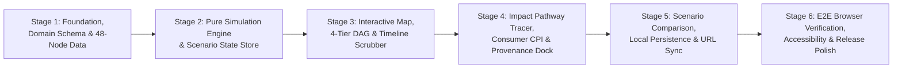

# ECONOLOOM — STAGED IMPLEMENTATION PLAN

**Document Status:** Phase 0 Execution Blueprint  
**Last Updated:** 2026-10-19

---

## 1. Sequencing Strategy & Improvement Rationale

To prevent building UI components against throwaway mock structures or hard-coded dummy numbers, we refine the classic six-stage sequence so that **strict domain types, the audited 48-node / 78-edge dataset, and referential integrity checks are established in Stage 1**, and **the pure deterministic simulation engine is implemented before wiring the temporal timeline and downstream impact explorer**:

*(Note: Compared to implementing the Simulation Engine in Stage 3 after the Map and Network UI, swapping the pure Simulation Engine into **Stage 2** ensures that when the Geographic View, Dependency Network, and Timeline Scrubber are built in **Stage 3**, they immediately bind to real, mathematically verified 26-week simulation state rather than temporary UI stubs.)*

---

## Stage 1 — Application Foundation, Domain Schema & Audited Dataset

### 1.1 Objective
Initialize the Vite + React + TypeScript + Tailwind workspace, configure the dark-first visual design system, define all strict TypeScript domain and provenance interfaces, compile the complete 48-node / 78-edge dataset (`src/data/`) with verified `SourceRecord` citations, and render the responsive 4-zone application shell.

### 1.2 Implementation Scope
- Scaffold project (`package.json`, `tsconfig.json` with `strict: true` and `noUncheckedIndexedAccess: true`, `vite.config.ts`, `tailwind.config.js`, `vitest.config.ts`).
- Implement CSS design tokens in `src/index.css` (`--bg-canvas`, `--stress-none` through `--stress-severe`, `--mitigation-cyan`, typography rules).
- Create `src/types/domain.ts`, `src/types/simulation.ts`, and `src/types/ui.ts`.
- Create `src/data/sources.ts` (all verified `SourceRecord` and `ModelAssumption` entries), `src/data/nodes.ts` (48 nodes across 5 categories), `src/data/edges.ts` (78 directed edges), `src/data/corridors.ts` (geographic shipping/pipeline geometries), `src/data/presets.ts` (Strait of Hormuz, Taiwan Semiconductor Foundries, Panama Canal Drought), and bundle `src/data/geo/world-110m.json` (Natural Earth Public Domain TopoJSON).
- Implement `src/engine/validateNetwork.ts` to verify node/edge referential integrity, source citation resolution, weight bounds, and DAG tier structure.
- Build core reusable UI primitives (`DataTierBadge`, `SeverityBadge`, `AppHeader`, and responsive `WorkspaceShell`).

### 1.3 Explicit Acceptance Criteria
1. `npm run typecheck` and `npm run build` succeed with zero TypeScript or bundler errors.
2. `validateNetwork()` passes with zero errors on the bundled 48-node, 78-edge dataset.
3. Every node and edge parameter in `src/data/` resolves to at least one valid `SourceRecord.id` and carries an explicit `DataClassification` value.
4. `WorkspaceShell` renders the dark-first header, epistemic guardrail pill, and responsive layout slots cleanly at desktop (`1440×900`) and mobile (`390×844`).

### 1.4 Verification Tests (`src/test/dataIntegrity.test.ts`)
- Assert exact node count (`48`), category breakdown (`3 chokepoints`, `9 geographies`, `14 commodities`, `14 industries`, `8 consumer_categories`), and edge count (`78`).
- Assert no dangling `sourceNodeId`, `targetNodeId`, or `sourceIds` references exist.
- Assert all numeric parameters (`dependencyStrength`, `bottleneckCriticality`, `inventoryBufferWeeks`, `bypassCapacityShare`) are finite and within valid bounds.

### 1.5 Dependencies & Remaining Risks
- **Dependencies:** None (Initial stage).
- **Remaining Risks:** Ensuring incoming edge weights at multi-input industry nodes are balanced so that one edge does not artificially dominate or under-represent real-world exposure (mitigated in Stage 2 engine tests).

---

## Stage 2 — Pure Simulation Engine & Canonical Scenario State Store

### 2.1 Objective
Implement the documented 26-week deterministic propagation, inventory buffer drawdown/replenishment, bypass rerouting, and Cost-Pressure Index (CPI) model as a pure, thoroughly unit-tested TypeScript module (`src/engine/`), and wire it to the canonical Zustand state store (`src/state/useScenarioStore.ts`) and Top Scenario Control Bar.

### 2.2 Implementation Scope
- Implement `src/engine/normalizeInputs.ts` to clamp and sanitize `ScenarioParameters` (handling `NaN`, `Infinity`, negative numbers, and out-of-range durations).
- Implement `src/engine/simulateScenario.ts` strictly following the mathematical equations in [`SIMULATION_METHODOLOGY.md`](file:///c:/Users/User/Desktop/Salman/Projects/SIMULATION_METHODOLOGY.md):
  - Weekly active shock profile $\alpha_{\text{active}}(t)$ and post-disruption exponential recovery tail.
  - Lagged edge transmission $\delta_e(t)$ with bypass share $\tilde{\beta}_e$ and rerouting delay penalty $\Delta L_e^{\text{bypass}}$.
  - Anti-double-counting convex combination of weighted average shortfall $d_v^{\text{avg}}(t)$ and critical bottleneck shortfall $d_v^{\text{bot}}(t)$.
  - Substitution absorption $\tilde{\sigma}_v$, soft-rationed inventory drawdown $b_v^{\text{draw}}(t)$, post-shock replenishment $b_v^{\text{rep}}(t)$, Direct vs. Indirect $\text{REI}_v(t)$, and bounded $\text{CPI}_v(t)$.
- Implement `src/state/useScenarioStore.ts` managing active preset, custom parameters, current simulation week $t \in [0, 26]$, selected node/edge IDs, and memoized `SimulationRunResult`.
- Build `src/components/layout/ScenarioControlBar.tsx` with preset selector, synchronized slider + numeric inputs for Severity ($0–100\%$), Duration ($7–180\text{d}$), Inventory Buffer Multiplier ($0.5\times–2.0\times$), Mitigation Profile toggle, and Reset to Baseline button.

### 2.3 Explicit Acceptance Criteria
1. All 12 required modeling principles in [`SIMULATION_METHODOLOGY.md`](file:///c:/Users/User/Desktop/Salman/Projects/SIMULATION_METHODOLOGY.md) are satisfied and proved by automated unit tests.
2. Full 26-week simulation across all 48 nodes executes in $< 5\text{ ms}$ per parameter change.
3. Sliders and numeric inputs in `ScenarioControlBar` stay 100% synchronized and immediately update the canonical store.

### 2.4 Verification Tests (`src/test/engine.test.ts`)
- **Zero-Shock Test:** `severity = 0` yields $\text{REI}_i(t) = 0$ and $\text{CPI}_i(t) = 0$ for all 48 nodes and all 27 time points ($t = 0 \dots 26$).
- **Monotonicity Tests:** Increasing severity or duration strictly increases or maintains cumulative exposure; increasing buffer multiplier or mitigation profile reduces or delays peak exposure.
- **Directionality Test:** Shocking a terminal `consumer_category` node produces zero upstream exposure.
- **Determinism Test:** Repeated runs with identical inputs produce deeply identical objects.
- **Cycle & Fuzz Test:** Synthetic cyclic graphs and invalid numeric inputs (`NaN`, `-100`, `Infinity`) never throw or output `NaN`/`Infinity`.

### 2.5 Dependencies & Remaining Risks
- **Dependencies:** Stage 1 domain schema and 48-node dataset.
- **Remaining Risks:** Parameter tuning across the three presets to ensure each preset clearly demonstrates distinct temporal phases (buffer absorption $\to$ stockout inflection $\to$ recovery tail).

---

## Stage 3 — Synchronized Geographic View, Dependency Network & Simulation Timeline

### 3.1 Objective
Build the interactive Geographic Map (`d3-geo`), the deterministic 4-Tier Directed Dependency Network (`d3-shape` + SVG), and the 26-Week Simulation Timeline Scrubber & Time-Series Chart, all synchronized through `useScenarioStore`.

### 3.2 Implementation Scope
- Implement `src/components/map/GeographicView.tsx` using `d3-geo` (`geoNaturalEarth1`) and bundled `world-110m.json`, rendering regional hub halos, pulsing chokepoint beacons, primary disrupted shipping/pipeline arcs, and active bypass corridors (`--mitigation-cyan`), plus `MapFallbackMatrix.tsx`.
- Implement `src/engine/graphLayout.ts` and `src/components/network/DependencyNetwork.tsx` rendering the 4-tier left-to-right DAG (`Chokepoints/Geographies` $\to$ `Commodities` $\to$ `Industries` $\to$ `Consumer Categories`) with colorblind-safe badges, directional flow indicators, pan/zoom, and `NetworkFilterBar.tsx` (`All`, `1-Hop`, `2-Hop`, Category filter, Min-$\text{REI}$ threshold).
- Implement `src/components/timeline/SimulationTimeline.tsx` with interactive week scrubber ($t = 0 \dots 26$), Play/Pause animation loop, Disruption Window vs. Recovery Window shading, synchronized SVG multi-series chart ($\text{REI}(t)$, $I(t)$, $\text{CPI}(t)$), and `AccessibleTimeTable.tsx`.

### 3.3 Explicit Acceptance Criteria
1. Selecting any node on the Map or in the Dependency Network highlights the entity in both views and updates the Timeline chart to plot that node's 26-week trajectory.
2. Scrubbing the Timeline from Week 0 to Week 26 updates node/edge colors, inventory bars, and map halos smoothly at 60fps with zero layout shift.
3. Applying graph filters (`1-Hop`, `2-Hop`, or Min-$\text{REI}$) declutters the network cleanly and displays a clear empty-state reset button if filters exclude all nodes.

### 3.4 Verification Tests (`src/test/stage3Views.test.tsx`)
- Test that clicking a node in `DependencyNetwork` or `GeographicView` updates `selectedNodeId` in the store.
- Test that changing `currentWeek` on the Timeline Scrubber updates displayed $\text{REI}$ badges in the DOM.
- Test that `NetworkFilterBar` controls filter rendered nodes and that the empty-state reset restores the graph.

### 3.5 Dependencies & Remaining Risks
- **Dependencies:** Stage 1 & Stage 2.
- **Remaining Risks:** Visual overlap of cubic Bézier edges in the 4-tier DAG when all 78 edges are visible simultaneously (mitigated by vertical rank ordering that minimizes edge crossings and dimming non-connected edges when a node is selected).

---

## Stage 4 — Impact Pathway Explorer, Consumer Cost-Pressure & Provenance Inspector

### 4.1 Objective
Implement the causal pathway tracer (`src/engine/pathwayTracer.ts`) and the 3-tab Right Inspector Dock (`Node & Edge Inspector`, `Impact Pathway Explorer`, and `Evidence & Provenance`), plus the in-app `MethodologyModal`.

### 4.2 Implementation Scope
- Implement `src/engine/pathwayTracer.ts` using a directed bottleneck-weighted path search to extract the primary and secondary causal chains from the active shock origin(s) $\mathcal{S}_0$ to any selected downstream `industry` or `consumer_category` node, computing cumulative lag and identifying the tightest intermediate bottleneck along the chain.
- Build `src/components/inspector/NodeInspectorPanel.tsx` displaying node role, baseline metric, Direct vs. Indirect $\text{REI}(t)$ breakdown bar, Remaining Inventory Buffer gauge, and clickable lists of incoming suppliers and outgoing dependents.
- Build `src/components/inspector/ImpactPathwayPanel.tsx` allowing users to select any downstream industry or consumer category, highlighting its causal chain on the Map and Network, rendering step-by-step intermediate hop cards, and displaying the Consumer Category **Cost-Pressure Index (0–100)** and **Illustrative Input Exposure Breakdown** (with explicit guardrails against retail price percentage claims).
- Build `src/components/inspector/ProvenancePanel.tsx` and `src/components/methodology/MethodologyModal.tsx` exposing full `SourceRecord` citations, licences, transformation notes, `DataClassification` badges, and `ModelAssumption` records.

### 4.3 Explicit Acceptance Criteria
1. Selecting any exposed consumer category (e.g., `con_groceries`, `con_vehicles`, `con_smartphones`) traces and highlights a valid directed chain back to the active shock origin and explains each intermediate step.
2. Consumer impact readouts display the bounded **Cost-Pressure Index (0–100)** and qualitative severity band, and explicitly distinguish `derived` vs. `illustrative` BOM cost shares.
3. Clicking any provenance badge opens the corresponding source citation and model assumption details.

### 4.4 Verification Tests (`src/test/pathwayAndInspector.test.tsx`)
- Unit test `traceImpactPathways()` across all 3 presets to verify that every exposed consumer category yields a connected directed path from `shockOriginNodeId` with monotonically increasing cumulative transit lag.
- Component test `NodeInspectorPanel`, `ImpactPathwayPanel`, and `ProvenancePanel` to verify accurate rendering of Direct/Indirect $\text{REI}$, BOM components, and `SourceRecord` metadata.

### 4.5 Dependencies & Remaining Risks
- **Dependencies:** Stages 1–3.
- **Remaining Risks:** Ensuring non-exposed nodes in a given preset (e.g., agricultural grain logistics during a pure Taiwan fab shock) display a clear, helpful "0.0 Exposure — Unconnected Pathway" explanation in `ImpactPathwayPanel`.

---

## Stage 5 — Scenario Comparison, Local Persistence & Shareable URL State

### 5.1 Objective
Enable users to save scenario configurations locally (`localStorage`), export/import scenario JSON, share scenarios via URL query parameters, and compare any two scenarios (or Active vs. Baseline) side-by-side.

### 5.2 Implementation Scope
- Implement `src/engine/compareScenarios.ts` computing parameter deltas ($\Delta S, \Delta D, \Delta \mu_{\text{inv}}, \Delta m$) and node-level outcome deltas ($\Delta \text{Peak REI}_i$, $\Delta \text{Stockout Week } t^*_i$, $\Delta \text{Week-26 Residual}_i$, and weekly time-series difference curves).
- Implement `src/state/persistence.ts` with Zod runtime validation for saving, listing, deleting, and restoring scenarios in `localStorage` (`econoloom.scenarios.v1`), with graceful fallback if storage is unavailable or corrupted.
- Implement `src/state/urlState.ts` for encoding/hydrating scenario parameters in the URL query string.
- Build `src/components/comparison/ComparisonDrawer.tsx` presenting the side-by-side Parameter Delta Table, Overlaid Time-Series Trajectory Chart (Scenario A vs. Scenario B / Baseline), and Top Affected Nodes Delta Ranking.

### 5.3 Explicit Acceptance Criteria
1. Users can save a custom scenario, reload the page, and restore their saved scenario from `localStorage`.
2. Corrupted or schema-invalid data in `localStorage` or URL parameters never crashes the app and falls back cleanly to Preset 1 with a user-visible notification.
3. The Comparison Drawer accurately displays both parameter differences and outcome deltas between any two configurations, with explicit framing that both configurations are conditional simulations.

### 5.4 Verification Tests (`src/test/persistenceAndComparison.test.tsx`)
- Unit test `compareScenarios()` verifying exact delta math when comparing Baseline vs. Preset 1 and Preset 1 (No Bypass) vs. Preset 1 (Enhanced Bypass + 1.5x Buffers).
- Unit test `persistence.ts` with valid JSON, malformed JSON, and mocked `localStorage` quota exceptions.

### 5.5 Dependencies & Remaining Risks
- **Dependencies:** Stages 1–4.
- **Remaining Risks:** Keeping the Comparison Drawer legible on smaller laptop screens without obscuring the main workspace (solved via an expandable bottom drawer / modal sheet).

---

## Stage 6 — End-to-End Verification, Accessibility, Responsive Polish & Deployment Docs

### 6.1 Objective
Execute the full automated test suite (`typecheck`, `lint`, `vitest`, production `build`, and `Playwright` real-browser smoke tests), verify responsive layouts and keyboard accessibility, inspect for zero console errors, and finalize `README.md` deployment instructions.

### 6.2 Implementation Scope
- Write and execute Playwright end-to-end tests (`e2e/smoke.spec.ts`) verifying preset switching, slider/input synchronization, map & graph selection, timeline scrubbing, pathway tracing, scenario comparison, local persistence, responsive mobile layout (`390×844`), and zero `console.error` / `pageerror` events.
- Audit keyboard navigation (`Tab`, `Shift+Tab`, `Enter`, `Space`, `ArrowLeft`/`ArrowRight` on timeline and graph nodes), focus rings (`--focus-ring`), and ARIA attributes.
- Optimize bundle splitting if needed and document build, verification, and static deployment steps in `README.md`.

---

## Implementation Progress Log

- **Stage 1 (Foundation & Audited Dataset):** Complete and verified (`48` nodes, `78` directed edges, `3` corridors, `3` presets, `14` sources, DAG validator).
- **Stage 2 / Milestone 3 (Deterministic 26-Week Simulation Engine, Scenario Controls, Timeline & Inspector):** Complete and verified (`normalizeInputs.ts`, `simulateScenario.ts`, `pathwayTracer.ts`, `ScenarioSelectorBar.tsx`, `SimulationTimeline.tsx`, `NodeBaselineInspector.tsx`).
- **Stage 3 / Milestone 4 (Interactive Directed Dependency Graph & Geographic Map):** Complete and verified (`graphLayout.ts`, `DependencyNetwork.tsx`, `worldLandmarks.ts`, `WorldMap.tsx`, `MapFallbackMatrix.tsx`, and `graphAndMap.test.tsx`).

### 6.3 Explicit Acceptance Criteria
1. `npm run typecheck`, `npm run lint`, `npm test`, `npm run build`, and `npx playwright test` all execute and pass with 0 errors.
2. Live browser inspection confirms zero console errors, zero broken visual assets, and full responsive usability on desktop and mobile viewports.

### 6.4 Dependencies & Remaining Risks
- **Dependencies:** Stages 1–5.
- **Remaining Risks:** Headless browser SVG bounding-box sizing in automated tests (mitigated by providing deterministic fallback `viewBox` dimensions on all SVG canvases).
