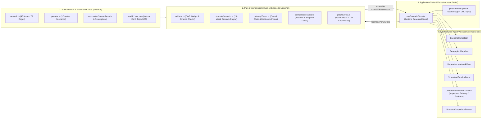

# ECONOLOOM — TECHNICAL ARCHITECTURE SPECIFICATION

**Document Status:** Phase 0 Baseline Specification  
**Last Updated:** 2026-10-19

---

## 1. Architectural Guiding Principles

1. **Pure, Deterministic Simulation Core:** The economic shock engine (`src/engine/`) is written in pure, zero-dependency TypeScript. It accepts immutable domain data and scenario parameters and returns a complete, immutable 26-week `SimulationRunResult`. **UI components are strictly forbidden from inventing, approximating, or recalculating economic outcomes.**
2. **Client-Only, Zero-Backend, Zero-Secret Footprint:** The MVP is a static client-side single-page application (SPA) built with Vite. It requires no backend server, no database, no user authentication, and no third-party API keys.
3. **Offline-Capable Vector Visualizations:** Both the Geographic View and Dependency Network operate on locally bundled, version-controlled data (`Natural Earth 110m TopoJSON` and `src/data/network.ts`), eliminating external tile-server rate limits, CORS failures, or missing map keys.
4. **Strict Type Safety & Runtime Schema Validation:** TypeScript is configured with `"strict": true`, `"noUncheckedIndexedAccess": true`, and `"exactOptionalPropertyTypes": true`. External boundaries (`localStorage` persistence, URL query state, and JSON scenario import/export) are validated at runtime using **Zod**.

---

## 2. Technology Stack Evaluation & Selection Rationale

### 2.1 Core Framework, Build & Styling

| Layer | Selected Technology | Alternatives Considered | Selection Rationale |
| :--- | :--- | :--- | :--- |
| **UI Framework** | **React 18.3 + TypeScript 5.6** | Vue 3, SvelteKit, Vanilla TS | Industry-standard component model with rich accessible primitive ecosystems and seamless state synchronization across multiple complex SVG views. |
| **Build Tool** | **Vite 6** | Next.js, Webpack, Parcel | Instant HMR, fast Rollup production bundling, zero SSR/server complexity required for a client-first interactive research instrument. |
| **Styling System** | **Tailwind CSS 3.4 + CSS Custom Properties** | CSS Modules, Styled Components, Emotion | Zero runtime JS overhead; design tokens (`--bg-canvas`, `--stress-severe`, etc.) map cleanly to utility classes and SVG `fill`/`stroke` attributes. |
| **Accessible UI Primitives** | **Radix UI (`@radix-ui/react-*`) + `lucide-react`** | Headless UI, Material UI, Ant Design | Unstyled, WAI-ARIA compliant primitives (`Slider`, `Tabs`, `Dialog`, `Tooltip`, `Select`, `Popover`) that support full keyboard navigation without imposing a generic SaaS visual style. |

### 2.2 Dependency Network Visualization Evaluation

| Candidate | Visual Quality | Determinism & Layout Control | Bundle Size (Gzip) | Accessibility & DOM Inspection | Verdict |
| :--- | :--- | :--- | :--- | :--- | :--- |
| **1. Deterministic 4-Tier SVG DAG (`d3-shape` + Custom React SVG)** | **Excellent** (Crisp cubic Bézier links, custom HTML/SVG node badges, animated flow dashes) | **100% Deterministic** (Exact tier column $x$ and ranked $y$ coordinates) | **~8 KB** | **Native SVG DOM** (`<g role="button" tabIndex={0}>`, easy Playwright/RTL testing) | **SELECTED** |
| **2. React Flow (`@xyflow/react`)** | High | High (if paired with `dagre` / `elkjs`) | ~65 KB (+140 KB with `elkjs`) | Good, though nested wrapper divs add overhead for a fixed 48-node graph | Rejected (Unnecessary bundle weight for a structured 48-node 4-tier DAG) |
| **3. Cytoscape.js** | Moderate | High | ~115 KB | Poor (Canvas-based; opaque to screen readers and DOM tests) | Rejected (Canvas opacity hurts accessibility and styling precision) |
| **4. `d3-force` (Force-Directed Graph)** | Chaotic ("hairball") | **Non-deterministic** (Physics simulation jitters on filter/state updates) | ~15 KB | Moderate | Rejected (Violates deterministic layout clarity and obscures tier hierarchy) |

**Decision:** EconoLoom renders the 48-node Dependency Network using a **Deterministic 4-Tier React SVG Graph** (`Chokepoints & Geographies` $\rightarrow$ `Commodities` $\rightarrow$ `Industries` $\rightarrow$ `Consumer Categories`) powered by a pure layout calculator (`src/engine/graphLayout.ts`) and `d3-shape` (`linkHorizontal`) for smooth cubic Bézier curves, paired with `d3-zoom` for smooth pan/zoom and 1-hop/2-hop neighborhood focus.

### 2.3 Geographic View Visualization Evaluation

| Candidate | Offline / Zero-Key Reliability | Bundle Size (Gzip) | Corridor & Chokepoint Customization | Accessibility & Fallback | Verdict |
| :--- | :--- | :--- | :--- | :--- | :--- |
| **1. `d3-geo` + `topojson-client` + Bundled Natural Earth `110m` SVG** | **100% Offline / Zero API Keys** | **~28 KB** (including `world-110m.json`) | **Full SVG control** over great-circle shipping arcs (`geoInterpolate`), pulsing chokepoint beacons, and regional hub halos | **Native SVG elements** with `aria-label`, keyboard focus, and zero WebGL crashes | **SELECTED** |
| **2. MapLibre GL JS** | Requires external vector tile server (e.g., Protomaps/MapTiler) or large self-hosted PMTiles | ~240 KB | High, but WebGL layer setup adds complexity and fails in headless environments without GPU | Requires custom canvas fallback | Rejected (Tile server dependency & WebGL overhead unnecessary for global chokepoint scale) |
| **3. Leaflet** | Requires external raster tile URLs (OSM terms restrict heavy uncached app usage) | ~42 KB | Moderate (Mercator distortion on global shipping arcs) | Moderate | Rejected (External raster tile dependency) |

**Decision:** EconoLoom uses a **self-contained `d3-geo` (`geoNaturalEarth1` projection) + `topojson-client` Interactive Vector Map** bundled with a lightweight, public-domain Natural Earth `110m` TopoJSON file (`src/data/geo/world-110m.json`). If geometry parsing ever encounters an error, the component degrades gracefully to a structured **Regional Chokepoint & Hub Matrix View**.

### 2.4 Time-Series Charting & State Persistence

- **Time-Series Charts:** Custom responsive React SVG charts built with **`d3-scale` and `d3-shape`** (`~10 KB` gzipped total). This guarantees pixel-accurate alignment with the 26-week Timeline Scrubber, custom Disruption Window shading (`[1, T_{\text{end}}]`), synchronized hover/keyboard crosshairs, and zero React 18 defaultProps warnings (a known issue in older `Recharts` builds).
- **State Management:** **Zustand (`zustand` v5, `~1.5 KB`)** holding the canonical application state, paired with pure memoized selectors that invoke the deterministic simulation engine.
- **Validation & Persistence:** **Zod (`zod` v3)** validates `localStorage` payloads (`econoloom.saved_scenarios.v1`) and URL search parameters (`?preset=preset_hormuz_energy&s=60&d=90&b=1.0&m=baseline&w=8`).

---

## 3. Module Boundaries & Data Flow Architecture

### 3.1 Strict Separation of Responsibilities



### 3.2 Recommended Project Folder Structure

```text
econoloom/
├── index.html
├── package.json
├── tsconfig.json
├── vite.config.ts
├── tailwind.config.js
├── postcss.config.js
├── playwright.config.ts
├── src/
│   ├── main.tsx
│   ├── App.tsx
│   ├── index.css                     # Dark-first CSS variables & Tailwind directives
│   ├── types/
│   │   ├── domain.ts                 # Node, Edge, SourceRecord, DataClassification types
│   │   ├── simulation.ts             # SimulationParameters, WeeklyNodeState, PathwayTrace types
│   │   └── ui.ts                     # FilterState, InspectorTab, ViewMode types
│   ├── data/
│   │   ├── sources.ts                # Verified SourceRecord[] and ModelAssumption[] catalog
│   │   ├── nodes.ts                  # All 48 EconNode definitions with TraceableValue metadata
│   │   ├── edges.ts                  # All 78 DependencyEdge definitions with provenance
│   │   ├── corridors.ts              # Maritime & pipeline route coordinates for Geographic View
│   │   ├── presets.ts                # 3 ScenarioPreset definitions (Hormuz, Taiwan, Panama)
│   │   ├── index.ts                  # Unified, integrity-checked dataset export
│   │   └── geo/
│   │       └── world-110m.json       # Bundled Public Domain Natural Earth vector geometry
│   ├── engine/
│   │   ├── normalizeInputs.ts        # Clamps and sanitizes ScenarioParameters (prevents NaN/Inf)
│   │   ├── simulateScenario.ts       # Pure 26-week deterministic propagation & buffer engine
│   │   ├── pathwayTracer.ts          # Traces critical multi-hop paths from shock origin to target
│   │   ├── compareScenarios.ts       # Computes parameter deltas and node/timeline outcome deltas
│   │   ├── graphLayout.ts            # Computes deterministic 4-tier (x, y) node & Bézier positions
│   │   └── validateNetwork.ts        # Verifies referential integrity, source links & cycle safety
│   ├── state/
│   │   ├── useScenarioStore.ts       # Canonical Zustand store synchronizing all views
│   │   ├── persistence.ts            # Zod-validated localStorage & JSON import/export helpers
│   │   └── urlState.ts               # Optional non-destructive URL query parameter sync
│   ├── components/
│   │   ├── layout/
│   │   │   ├── AppHeader.tsx         # Brand, Epistemic Guardrail pill, Methodology & Compare triggers
│   │   │   ├── ScenarioControlBar.tsx# Preset selector, synchronized sliders/inputs, Run/Reset
│   │   │   └── WorkspaceShell.tsx    # Responsive 4-zone desktop & tabbed mobile layout manager
│   │   ├── map/
│   │   │   ├── GeographicView.tsx    # Interactive d3-geo SVG map with chokepoints & corridors
│   │   │   └── MapFallbackMatrix.tsx # Graceful tabular fallback if vector geometry fails
│   │   ├── network/
│   │   │   ├── DependencyNetwork.tsx # Interactive 4-tier directed SVG graph
│   │   │   └── NetworkFilterBar.tsx  # Hop depth, node category, and min-REI filter controls
│   │   ├── timeline/
│   │   │   ├── SimulationTimeline.tsx# 26-week scrubber, Play/Pause, phase badges & SVG chart
│   │   │   └── AccessibleTimeTable.tsx# Screen-reader summary table of key inflection weeks
│   │   ├── inspector/
│   │   │   ├── RightInspectorDock.tsx# Tab container (Entity Inspector | Impact Pathway | Evidence)
│   │   │   ├── NodeInspectorPanel.tsx# Direct/Indirect REI, Inventory gauge, incoming/outgoing links
│   │   │   ├── ImpactPathwayPanel.tsx# Step-by-step causal chain & Consumer Cost-Pressure breakdown
│   │   │   └── ProvenancePanel.tsx   # Source citations, licence, transformations & assumptions
│   │   ├── comparison/
│   │   │   └── ComparisonDrawer.tsx  # Side-by-side Baseline vs. Saved Scenario delta explorer
│   │   ├── methodology/
│   │   │   └── MethodologyModal.tsx  # In-app plain-English & mathematical methodology reference
│   │   └── common/
│   │       ├── DataTierBadge.tsx     # Visual pill for Observed / Derived / Parameter / Illustrative
│   │       └── SeverityBadge.tsx     # Colorblind-safe badge for REI / CPI qualitative bands
│   └── test/
│       ├── engine.test.ts            # Comprehensive unit tests for simulation & pathway math
│       ├── dataIntegrity.test.ts     # Verifies all 48 nodes, 78 edges & source citations
│       ├── persistence.test.ts       # Tests localStorage save/restore and corrupted JSON fallback
│       └── appIntegration.test.tsx   # RTL tests for synchronized UI controls & views
└── e2e/
    └── smoke.spec.ts                 # Playwright browser verification & zero-console-error checks
```

---

## 4. Testing, Verification & Quality Strategy

### 4.1 Four-Layer Verification Pyramid

1. **Static Analysis & Type Checking (`npm run typecheck && npm run lint`):**
   - `tsc --noEmit` with strict flags (`strict: true`, `noUncheckedIndexedAccess: true`).
   - ESLint enforcing zero unused variables, exhaustive `switch` checks on `NodeCategory` and `DataClassification`, and strict import boundary rules (`src/engine/` may never import from `src/components/`).
2. **Dataset & Provenance Integrity Tests (`src/test/dataIntegrity.test.ts`):**
   - Verifies that the network contains 48 valid nodes and 78 valid directed edges.
   - Verifies that every `sourceNodeId` and `targetNodeId` resolves to an existing node, every `sourceIds` array is non-empty and resolves to a valid `SourceRecord` in `src/data/sources.ts`, and all numeric weights lie within legal bounds.
3. **Simulation Engine Unit Tests (`src/test/engine.test.ts` via Vitest):**
   - **Zero-Shock Identity:** $S = 0 \implies \forall i, t: \text{REI}_i(t) = 0, \text{CPI}_i(t) = 0, I_i(t) = I_i^{\max}$.
   - **Monotonic Severity & Duration:** Increasing $S$ from $0.2 \to 0.6 \to 1.0$ or $D$ from $30 \to 90\text{ days}$ strictly increases or maintains cumulative exposure $\sum_t \text{REI}_i(t)$.
   - **Directionality & Unconnected Isolation:** Shocking a downstream `consumer_category` node never propagates backward to upstream `industry`, `commodity`, or `chokepoint` nodes.
   - **Buffer & Mitigation Efficacy:** Increasing `inventoryBufferMultiplier` from $0.5 \to 2.0$ or switching `mitigationProfile` from `restricted` $\to$ `enhanced` delays stockout onset week $t^*_i$ and reduces peak $\text{REI}_i$.
   - **Determinism:** Calling `simulateScenario()` 100 times with identical inputs returns deeply equal (`toEqual`) results.
   - **Cycle & Boundary Safety:** Injecting a synthetic 2-node cycle and extreme out-of-range inputs (`severity: -5`, `durationDays: 99999`, `NaN`) normalizes safely and produces zero `NaN` or `Infinity` values.
4. **Component Integration & Browser Smoke Tests (`Vitest + RTL` & `Playwright`):**
   - Switching presets updates the active title, sliders, map origin, and network selection.
   - Synchronized slider and numeric input edits update each other and recompute the view.
   - Clicking a graph node updates the Right Inspector and Timeline series.
   - Scrubbing the timeline updates the displayed week and node exposure readouts.
   - Saving a scenario to `localStorage`, modifying parameters, and comparing scenarios displays accurate deltas; corrupted `localStorage` payloads recover without crashing.
   - Playwright browser check confirms zero `console.error` or uncaught `pageerror` events across desktop (`1440×900`) and mobile (`390×844`) viewports.

---

## 5. Deployment Approach

- The application compiles via `npm run build` into a self-contained static `dist/` directory (`index.html` + hashed JS/CSS bundles, target total gzipped size $< 180\text{ KB}$).
- Can be hosted on any static CDN (Cloudflare Pages, Vercel, Netlify, GitHub Pages, or local static file server via `npx vite preview`) with zero server-side runtime dependencies or environment variables.

---

## 6. Milestone 4 Implementation Record: Interactive Dependency Graph & Geographic Map

1. **Deterministic Directed Dependency Graph (`src/engine/graphLayout.ts` & `src/components/network/DependencyNetwork.tsx`):**
   - `computeGraphLayout(nodes, edges, options)` is a pure, deterministic TypeScript layout engine with zero React/DOM imports and zero random calls. It seeds each node's stage column by its semantic `tierIndex` ($0 \dots 3$) and relaxes topological column depth across all directed edges $(u \to v)$ so that 100% of the 78 directed edges flow strictly left-to-right ($x_u < x_v$). Within each column, 4 deterministic forward/backward sweeps of barycentric crossing minimization order nodes vertically with zero bounding-box overlaps.
   - `computeGraphNeighborhood(selectedNodeId, edges, pathways, maxHops)` computes upstream dependencies, downstream dependents, 1-hop neighbors, and active causal pathway node/edge sets.
   - `DependencyNetwork.tsx` renders all 48 nodes and 78 directed cubic Bézier edges dynamically from `NODES` and `EDGES`, with `<marker>` directional arrowheads, edge width proportional to `dependencyWeight.value`, Week-$t$ `transmittedDisruption` and `activeBypassShare` styling, interactive Edge Inspection drawer, node search, category filter, neighborhood focus (`All Network`, `1-Hop`, `2-Hop`, `Causal Pathways`), minimum REI filter, zoom/pan/fit-to-view, and empty-filter reset.
2. **Geographic Chokepoint & Trade Corridor Map (`src/data/geo/worldLandmarks.ts`, `src/components/map/WorldMap.tsx`, `src/components/map/MapFallbackMatrix.tsx`):**
   - `hasValidCoordinates(node.coordinates)` filters `NODES` at runtime: exactly **12 nodes** have verified `[longitude, latitude]` coordinates (`3 chokepoint` nodes + `9 geography` regional trade hubs). The **36 non-geographic nodes** (`14 commodity`, `14 industry`, `8 consumer_category`) are never assigned synthetic coordinates.
   - When a non-geographic node is selected, `WorldMap.tsx` displays an explicit **Non-Geographic Node Banner** explaining that the selected entity is a distributed supply-chain tier node and highlighting the upstream physical chokepoints and regional hubs that feed it.
   - Renders the 3 audited physical corridors from `src/data/corridors.ts` (`cor_hormuz_asia_europe`, `cor_taiwan_transpacific`, `cor_panama_canal_americas`) using `buildDatelineSafePolylineSegments` to split trans-Pacific segments cleanly at the $\pm 180^\circ$ antimeridian, plus dashed emerald bypass routes (`bypassWaypoints`).
   - Uses bundled Natural Earth 110m (CC0 Public Domain) continent vector outlines for 100% offline reliability, paired with an optional OSM/CARTO dark raster tile layer with automatic `onError` fallback, visible attribution (`Natural Earth 110m CC0 · © OpenStreetMap contributors · © CARTO`), and a toggleable `MapFallbackMatrix.tsx` tabular matrix view.
3. **Single-Store State Synchronization (`src/state/useScenarioStore.tsx`):**
   - `WorldMap`, `DependencyNetwork`, `SimulationTimeline`, `ScenarioSelectorBar`, and `NodeBaselineInspector` all read from and dispatch to `useScenarioStore` (`selectedNode`, `selectedEdge`, `currentWeek`, `scenarioParams`, `canvasViewMode`).

